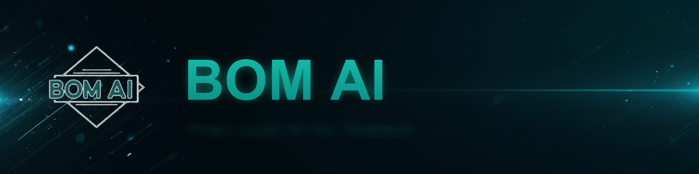

# BOM AI



> Free Thai-first AI assistant that runs on your own computer. Local inference via [Ollama](https://ollama.com) + [Open WebUI](https://openwebui.com).

[bomai.app](https://bomai.app) · [Download](https://bomai.app/download) · [ภาษาไทย](README.th.md)

## Read this first (honest disclosure)

- BOM AI uses **small local models** and can produce incorrect, incomplete, repetitive, or OCR results. Verify important information.
- **Chat runs locally** with no internet needed while chatting, but **installation** and **web search** use the internet, and web search sends your queries to external search services.
- The app shows an **XM partner banner** that loads creatives remotely.
- The safety gateway blocks defined phishing requests, but no rule-based filter can guarantee detection of every harmful prompt or output.
- Installers are **unsigned** — Windows SmartScreen and macOS Gatekeeper may warn (the download page explains how to proceed).
- The installer creates a **local admin account** on your machine (public signup is disabled; you log in with that account).
- "Heal the World" mission: free AI education for Thai communities.

## Model Tiers (v2.0.0)

| Tier | Download | Requirement | Best for |
|------|----------|-------------|----------|
| **Light 4.2B** ⭐ | ~3.4 GB | 8 GB RAM | Any PC without GPU — recommended for most users |
| **Pro 11.8B** | ~7.9 GB | GPU 12 GB+ VRAM | Machines with a GPU — deeper answers |
| Production | — | — | Deferred (not shipped in this version) |

Registry (Ollama): `siamcafe/bom-ai:light-v2.0.0` · `siamcafe/bom-ai:pro-v2.0.0` (v1.0.0 tags remain; same weights).

## Quick Start

### Windows
1. Download `Install-BOM-AI-Online.bat` (~0.3 MB) from [bomai.app/download](https://bomai.app/download)
2. Double-click it — the installer fetches required components (~3 GB+)
3. If SmartScreen warns: "More info" → "Run anyway"

### macOS
1. Download `install-bom-ai-mac.zip` from [bomai.app/download](https://bomai.app/download)
2. Unzip it in Finder
3. Double-click `install-bom-ai-mac.command` (if Gatekeeper warns: right-click → Open)

### Linux
```bash
curl --fail --location --proto '=https' -o install-bom-ai-linux.sh \
  https://bomai.app/dl/install-bom-ai-linux.sh
bash install-bom-ai-linux.sh
```

SHA-256 hashes for every file are always available at [bomai.app/download](https://bomai.app/download) and in `/dl/release.json`.

## System Requirements

- Windows 10 (1903)+, macOS 12+, or Ubuntu 22.04+
- Light: 8 GB RAM · Pro: GPU with 12 GB+ VRAM
- ~10-40 GB free disk space depending on tier
- Internet required for installation (and for web search while using it)

## How It Works

- **Local stack**: [Ollama](https://ollama.com) serves the model; [Open WebUI](https://openwebui.com) provides the chat UI; everything binds to loopback only.
- **Vision**: the models read Thai text inside images — receipts, signs, screenshots, charts (OCR can still misread).
- **Web search**: optional, powered by a local SearXNG instance; queries go to public search providers while enabled.
- **Thinking toggle**: OFF (default) answers in a single pass; ON allows one quality rewrite pass for better answers (longer wait; the model's reasoning is never exposed).
- **GOD CONFIG v7.0 (locked)**: temperature 0.6, top_p 0.95, top_k 20, repeat_penalty 1.0, presence_penalty 0.0, num_ctx 8192, num_predict 4096. `think=false` is a request-level field enforced by the gateway on every upstream call — not a Modelfile parameter.

## QC Status

Current status: **candidate / HOLD** — the 312-case browser suite (52 prompts × Light/Pro × 3 OS) is being re-run on the final v2.0.0 bytes.
Final QC numbers will be published here only when that run completes. We do not claim unfinished results.

Known limitations, stated plainly: small models can get facts wrong (e.g., history); long list answers can loop (the guard stops loops, but a stopped answer is incomplete); OCR can misread characters.

## FAQ

**Is it really free?**
Yes — no subscription and no usage cap. The app displays an XM partner banner.

**Does it need internet?**
For installation and updates, yes. Chat itself runs locally; web search (optional) uses the internet and sends your query to search providers.

**Is it safe?**
Everything runs on your own computer and binds to loopback. The installer creates a local admin account — public signup is disabled. Safety filters block defined phishing requests, but no filter is perfect. Installers are unsigned; verify SHA-256 hashes from the download page.

**Where does my chat data go?**
Chats and images stay on your computer. Web search queries are sent to external services while that feature is in use, and the partner banner loads from a remote server.

**Does it run on old computers?**
Any 8 GB RAM machine runs Light. Pro needs a 12 GB+ VRAM GPU.

**Mobile?**
Not in this version — BOM AI is designed for desktop computers.

## Release Notes

### v2.0.0 (2026-11) — Final Close
- One canonical version **2.0.0** across website, installers, registry, manual
- Clear tiers: **Light 4.2B** and **Pro 11.8B** (Production deferred)
- Thinking toggle (bounded two-pass) — better answers when ON, no reasoning exposure
- macOS distribution switched to ZIP + `.command` (the `.sh` script is retired)
- Honest copy: local chat, internet for install/search, partner banner present, installers unsigned

### v2.0.0 (2026-11-02) — Fleet Sync
- Infrastructure sync with BOM LLM v10.0.0 (Open WebUI v0.12.5)

### Earlier
- v0.3.2 (2026-10-30) / v0.3.1-rc.1 (2026-10-28) — earlier Thai VL line (retired). Some claims published at that time (code signing, zero-Han perfection, QC 20/20) were not accurate and are retracted.

## Contributing

We'd love help with:

- Adapting BOM AI for other languages/regions — the pattern generalizes
- Thai instruction datasets for model training
- Installer improvements (Windows / macOS / Linux)

## Credits

Built by [iCafeFX](https://icafefx.ai) · [SiamCafe](https://siamcafe.net) ·
Powered by [Ollama](https://ollama.com) and [Open WebUI](https://openwebui.com)

## License

MIT — see [LICENSE](LICENSE). Open WebUI keeps its own BSD-3-Clause license;
model base licenses apply to their respective weights.
