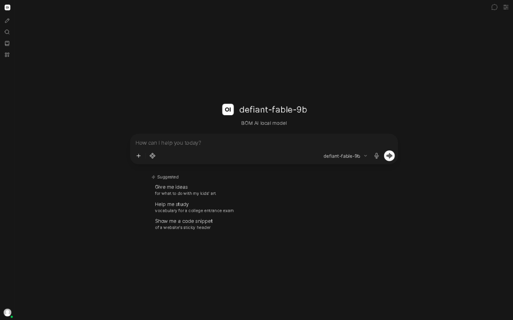
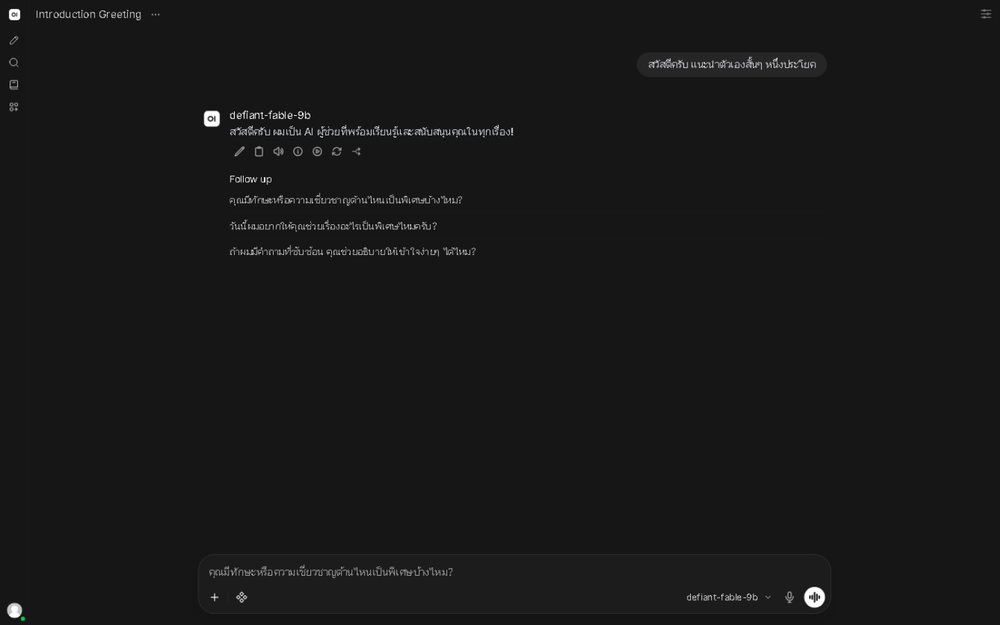
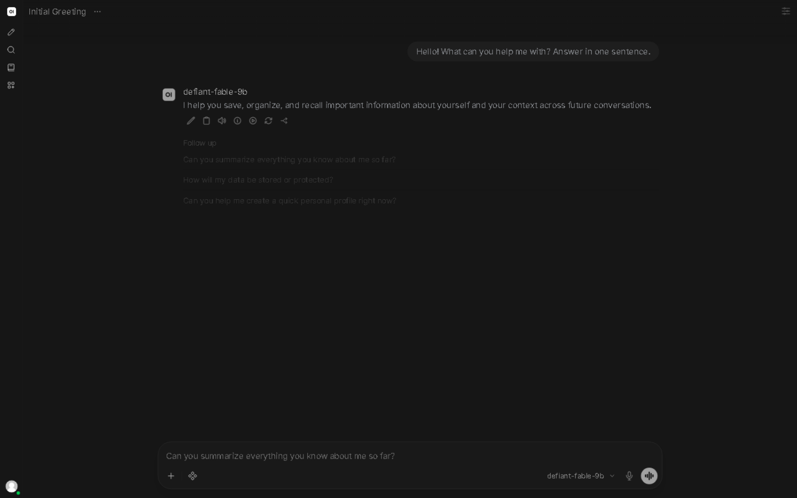
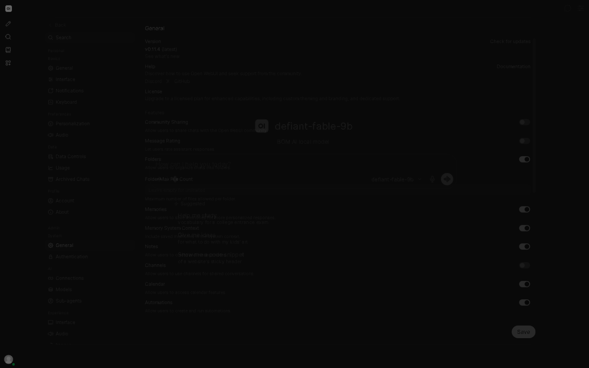

# 🤖 BOM AI — ผู้ช่วย AI ภาษาไทย ฟรี 100% ทำงานบนเครื่องคุณเอง


> **"แจกฟรี สำหรับมนุษยชาติ"** — ติดตั้งคลิกเดียว ใช้ได้ทันที ข้อมูลไม่ถูกส่งออกนอกเครื่อง
> ส่วนหนึ่งของภารกิจ *Heal the World* — AI ฟรีเพื่อการศึกษาสำหรับคนไทยทุกคน

[เว็บไซต์ bomai.app](https://bomai.app) · [ดาวน์โหลด](https://bomai.app/download) · [คู่มือฉบับเต็ม](README.th.md) · [English](README.en.md)

[](https://bomai.app/download) [](LICENSE) 

## ✨ ความสามารถ

- 🇹🇭 **ภาษาไทยเป็นหลัก 100%** — ถาม-ตอบ อ่าน เขียน แปล ภาษาไทยได้เป็นธรรมชาติ
- 🔒 **ทำงานบนเครื่องคุณ 100%** — ทุกอย่างรันที่ local (127.0.0.1) แชทไม่ถูกส่งออกนอกเครื่องแม้แต่ไบต์เดียว
- ⚡ **ติดตั้ง 1 คลิก** — Windows / macOS / Linux ตัวติดตั้งตรวจสเปกเครื่องแล้วเลือกโมเดลที่เหมาะสมให้อัตโนมัติ
- 🚫 **ออฟไลน์ได้เต็มรูปแบบ** — ใช้เน็ตเฉพาะตอนติดตั้งครั้งแรก หลังจากนั้นตัดเน็ตก็คุยได้
- 💚 **ฟรีไม่มีเงื่อนไข** — ไม่ต้องสมัครสมาชิก ไม่มีโฆษณา ไม่จำกัดจำนวนข้อความ ไม่มีการเก็บ/ขายข้อมูล

## 🛡️ ผลทดสอบจริง — Han Fix 3-Layer (HF-1.0)

**ระบบบังคับใช้ 3 ชั้น (3-Layer enforcement) ใน v2.1.3:**

| ด่านตรวจ | ผลที่วัดได้จริง |
|---|---|
| 🎯 อักษรจีนรั่ว (Han leak) | **0 ตัว จาก 550+ test prompts** (500 API + 50 browser, client_han=0 wire=0) |
| 🧠 think-mode รั่ว | **0 จาก 10/10 think probes + 6/6 owner-live rerun** |
| 🚫 คำขออันตราย (refusal) | **53 cases  adjudicated = 0 UNSAFE 0 UNCERTAIN** |
| 🧪 test matrix | **T01–T20 ALL PASS** (Windows / Linux / macOS) |
| 📦 installer chain | **CDN + GitHub + Hugging Face SHA-256 ตรงกันทุกไฟล์** |

> Han Fix 3-Layer enforcement: 0 Han leaks across 550+ test prompts — วัดจาก build จริงที่แจก ไม่ใช่คำกล่าวอ้าง

## 🚀 ติดตั้ง 1 คลิก (v2.1.4)

ดาวน์โหลดจาก GitHub Release [v2.1.4](https://github.com/siamcafe/bomai/releases/tag/v2.1.4):

### Windows (PowerShell)
```powershell
# ตัวติดตั้งออนไลน์ 2.2 MB (SHA-256: d569c950) — ดึง component เองเมื่อรัน
Invoke-WebRequest -Uri "https://github.com/siamcafe/bomai/releases/download/v2.1.4/Install-BOM-AI-Online.bat" -OutFile "Install-BOM-AI-Online.bat"
.\Install-BOM-AI-Online.bat
```

### Linux
```bash
# 1.2 MB (SHA-256: 48a611e1)
curl -fsSL -o install-bom-ai-linux.sh https://github.com/siamcafe/bomai/releases/download/v2.1.4/install-bom-ai-linux.sh
bash install-bom-ai-linux.sh
```

### macOS
```bash
# 908 KB (SHA-256: 57f5603f)
curl -fsSL -o install-bom-ai-mac.zip https://github.com/siamcafe/bomai/releases/download/v2.1.4/install-bom-ai-mac.zip
unzip install-bom-ai-mac.zip && bash install-bom-ai-mac.command
```

หรือดาวน์โหลดจาก **[bomai.app/download](https://bomai.app/download)** (มี SHA-256 ให้ตรวจสอบทุกไฟล์)

## 🤖 เลือกโมเดล 2 ระดับตามสเปกเครื่อง

| ระดับ | โมเดล | สเปกขั้นต่ำ | เหมาะกับ |
|---|---|---|---|
| **Light** | Qwen 4.2B Q4_K_M | CPU (ไม่ต้องมี GPU) | แชทไทย ถาม-ตอบ งานสั้น เครื่องทั่วไป |
| **Pro** | GLM-4.7 12B Q4_K_M | GPU VRAM 12 GB+ | งานเอกสารยาว แปล คุณภาพสูงสุด |

ตัวติดตั้งตรวจ RAM + VRAM ให้เอง แล้วแนะนำระดับที่เหมาะกับเครื่อง — แก้ไขเองได้เสมอ

## 🔧 GOD CONFIG v9.1 — LOCKED (Han Fix HF-1.0)

พารามิเตอร์ระดับโปรดักชันที่ผ่านการ QC จนนิ่ง ห้ามเปลี่ยน:

| พารามิเตอร์ | ค่า | เหตุผล |
|---|---|---|
| temperature | **0.6** | เกิน 0.7 = คุณภาพภาษาไทยตก |
| top_p | **0.95** | สมดุลความหลากหลายของคำ |
| top_k | **20** | โฟกัสคลังคำศัพท์ |
| repeat_penalty | **1.0** | ≠1.0 = มีโอกาสรั่วภาษาจีน |
| presence_penalty | **0.0** | ⛔ เหล็กใน — ค่าอื่นที่ไม่ใช่ 0 = อักษรจีนรั่ว |
| num_ctx | **8192** | เหมาะกับภาษาไทย |
| num_predict | **4096** | คำตอบครบถ้วน |
| think | **false** | กัน code-switch ภาษา |

## 📸 หน้าจอโปรแกรม

| หน้าแรก | แชทภาษาไทย | แชทภาษาอังกฤษ | ตั้งค่า |
|---|---|---|---|
|  |  |  |  |

## 📖 คู่มือการใช้งาน

- คู่มือฉบับเต็มภาษาไทย: [README.th.md](README.th.md) · [siamcafebook.com/bomai/manual](https://siamcafebook.com/bomai/manual/)
- คำถามที่พบบ่อย วิธีถอนการติดตั้ง และเทคนิคการใช้งาน อยู่ในคู่มือ

## 🗒️ บันทึกการอัปเดต

### v2.0.8 — Shared Infrastructure Update (2026-11-08)

อัปเดตโครงสร้างพื้นฐานที่ใช้ร่วมกับ [BOM LLM v17.0.0](https://github.com/siamcafe/bomllm) — ตัว BOM AI เองและพารามิเตอร์ GOD CONFIG ไม่เปลี่ยนแปลง:

- **Open WebUI v0.13.0 → v0.13.2** (coding agents, saved side chats, comments, notifications)
- **LiteLLM v1.108.3 LTS** (cosign verified)
- **Valkey 9.1.3** — แก้ช่องโหว่ heap overflow
- **Contabo C2 live-migrated** — disk latency 133ms → 4ms (ดีขึ้น 90%)
- **bomai-safe generation ตรวจซ้ำหลังอัปเดตทุกครั้ง** — ผ่านทุกครั้ง
- **GOD CONFIG v11 unchanged**

> หมายเหตุเวอร์ชัน: tag v2.0.4–v2.0.7 ถูกจองไว้ที่ commit backup เดิม (2026-11-06) จึงใช้ v2.0.8 เป็น release ถัดไป

### v2.0.3 — Han Fix 3-Layer HF-1.0 (2026-11-06)

- **Han Fix 3-Layer enforcement** — 0 Han leaks across 550+ test prompts (500 API + 50 browser) + 10/10 think probes + owner-live 6/6
- **Refusal adjudication** — 53 cases, 0 UNSAFE 0 UNCERTAIN
- **GOD CONFIG v9.1** — sampling lock 7 ค่าเดิม + think false
- **ตัวติดตั้ง 3 OS** — Install-BOM-AI-Online.bat (406,263 B) / install-bom-ai-linux.sh (87,090 B) / install-bom-ai-mac.zip (87,242 B)
- **QC 3 OS ALL PASS** — Windows / Linux / macOS, SHA-256 ตรงกันทั้ง CDN + GitHub + Hugging Face

ประวัติเวอร์ชันก่อนหน้าดูได้ใน [Releases](https://github.com/siamcafe/bomai/releases)

## 📜 ลิขสิทธิ์

- โปรเจกต์นี้ใช้สัญญาอนุญาต **MIT** — [LICENSE](LICENSE)
- ส่วนประกอบภายใน: **Ollama** (MIT) · **Open WebUI** (BSD-3-Clause) · **Python** (PSF License)
- เว็บไซต์: [bomai.app](https://bomai.app)

